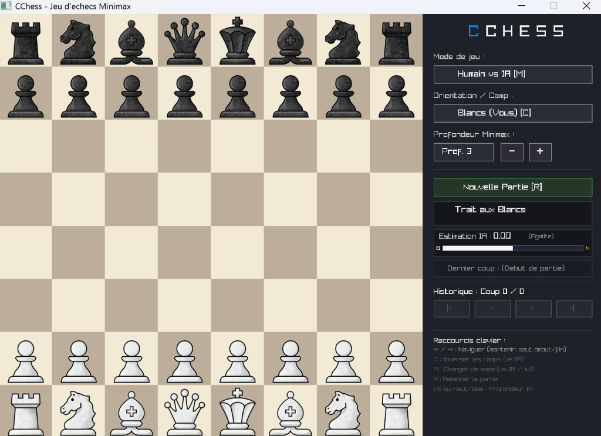

# CChess

Jeu d'échecs complet développé en **C** avec interface graphique interactive via [Raylib](https://www.raylib.com/).
Le moteur intègre une intelligence artificielle basée sur l'algorithme **Minimax** avec **élagage Alpha-Bêta**, **recherche de tranquillité (Quiescence Search)** et tables d'évaluation positionnelle (**Piece-Square Tables**).

<p align="center">
  
</p>

---

## 🎯 Contexte & Origine du projet

Ce projet est né lors de ma première année de classe préparatoire scientifique (CPGE au Centre International de Valbonne - CIV). 

Avec un camarade, nous nous étions lancé le défi amical de concevoir chacun notre propre moteur d'échecs en C pour faire s'affronter nos intelligences artificielles. Ce challenge stimulant a été le point de départ d'une exploration poussée de l'algorithmique de jeu, de l'optimisation bas-niveau et de la gestion de la mémoire en C. Le projet a ensuite évolué pour intégrer une interface graphique moderne et réactive, ainsi que des fonctionnalités complètes de jeu et d'analyse.

---

## ✨ Fonctionnalités clés

- **IA Minimax ultra-rapide** : Élagage Alpha-Bêta optimisé avec ordonnancement prioritaire des captures (**< 0,4 s** à profondeur 5).
- **Évaluation de position en temps réel** :
  - Score chiffré en pions (ex: `+1.35`, `-2.10`, `0.00`).
  - Détection et affichage des mats forcés (`+Mat` / `-Mat`).
  - Jauge visuelle dynamique inspirée des plateformes modernes (Lichess, Chess.com).
- **Recherche de tranquillité (Quiescence Search)** : Résolution complète des échanges de pièces aux feuilles de l'arbre et détection rigoureuse des échecs et mats (élimination de l'effet d'horizon).
- **Piece-Square Tables (PST)** : Évaluation positionnelle stratégique dynamique pour chaque type de pièce.
- **Prise en compte complète des règles FIDE** : Roque complet (vérification des cases de passage, sécurité du roi), pat et échec et mat.
- **Historique & Timeline interactive** : Navigation coup par coup (`<-` / `->`, `|<` / `>|`), reprise de position et bifurcation de partie.
- **Changement de camp & Inversion dynamique (Touche `C`)** : Rotation à 180° du plateau et des clics souris en pleine partie sans réinitialisation.
- **Mode 1v1 Local & Humain vs IA (Touche `M`)** : Rotation automatique de l'échiquier au trait en mode 1v1.
- **Architecture mémoire saine** : Allocation sur la pile, `0 malloc/free`, garantissant zéro fuite mémoire.

---

## 📁 Structure du projet

```
CChess/
├── src/
│   ├── main.c        # Boucle principale, gestion des événements et de l'UI
│   ├── board.c/h     # Représentation de l'échiquier, conventions et déplacements
│   ├── rules.c/h     # Règles d'échecs, coups légaux, détection d'échec et roque
│   ├── ai.c/h        # Évaluation PST, Minimax, Alpha-Bêta et Quiescence Search
│   ├── renderer.c/h  # Moteur de rendu graphique Raylib
│   └── settings.h    # Constantes et dimensions
├── img/              # Sprites des pièces et texture de l'échiquier
├── Makefile          # Script de build multiplateforme (Windows, Linux, macOS)
├── LICENSE           # Licence MIT
└── README.md
```

---

## 🛠️ Compilation & Lancement

### Prérequis
- Compilateur gcc
- Bibliothèque Raylib installée

### Compilation
```bash
make
```

### Lancer le jeu
  ```bash
  ./chess
  ```

---

## 🎮 Contrôles & Raccourcis

| Entrée | Action |
| :--- | :--- |
| **Clic gauche** | Sélectionner et déplacer une pièce, interagir avec l'interface |
| **Flèches `<-` / `->`** | Reculer / avancer coup par coup dans l'historique |
| **Maintenir `<-` / `->`** | Sauter directement au début ou à la fin de la partie |
| **Flèches `Haut` / `Bas`** | Ajuster la profondeur de calcul de l'IA (1 à 6) |
| **Chiffres `1` à `6`** | Définir directement la profondeur de recherche de l'IA |
| **Touche `C`** | Inverser les camps (vs IA) avec rotation du plateau |
| **Touche `M`** | Basculer de mode (**Humain vs IA** $\longleftrightarrow$ **1v1 Local**) |
| **Touche `R`** | Relancer une nouvelle partie |

---
